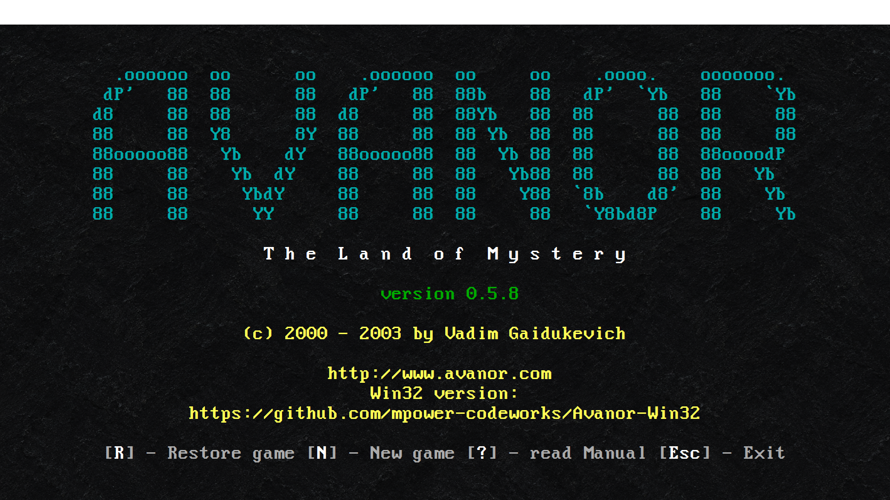
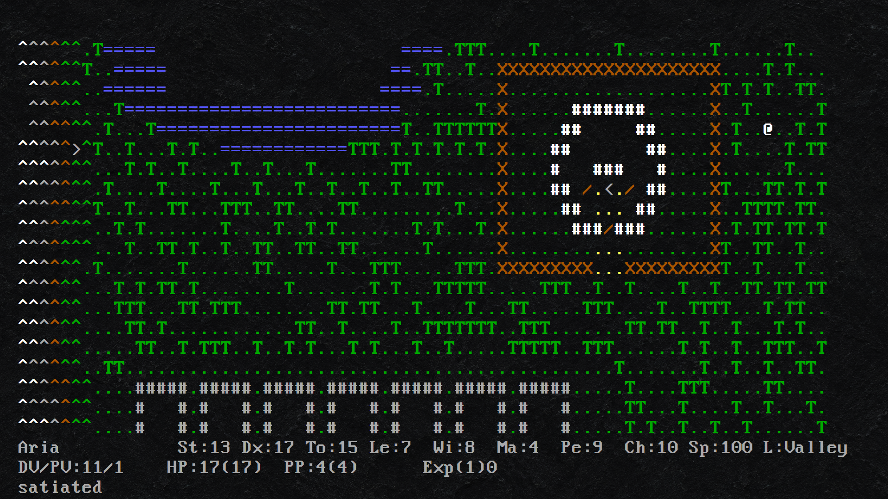
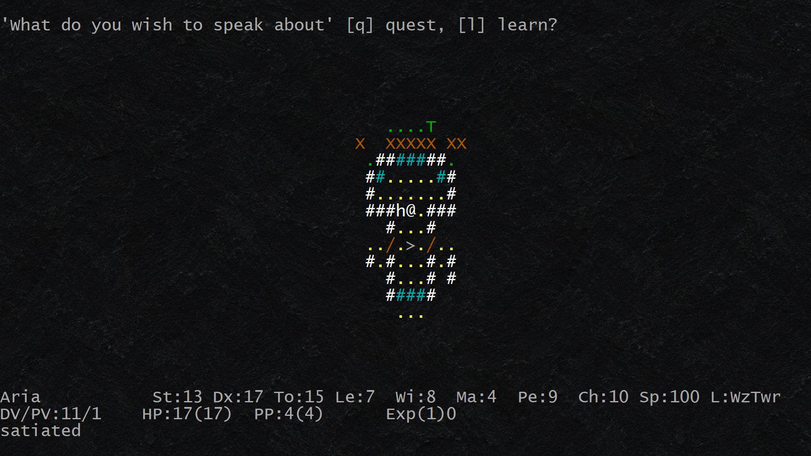

<!-- Original game 2000-2005 by Vadim Gaidukevich.
Avanor-Win32 is a native Win32/GDI port of Avanor,
original game 2000-2005 by Vadim Gaidukevich.
-->
𝖠𝗏𝖺𝗇𝗈𝗋-𝖶𝗂𝗇𝟥𝟤 𝗂𝗌 𝖺 𝗇𝖺𝗍𝗂𝗏𝖾 𝖶𝗂𝗇𝟥𝟤/𝖦𝖣𝖨 𝗉𝗈𝗋𝗍 𝗈𝖿 𝖠𝗏𝖺𝗇𝗈𝗋,
𝗈𝗋𝗂𝗀𝗂𝗇𝖺𝗅 𝗀𝖺𝗆𝖾 𝟤𝟢𝟢𝟢-𝟤𝟢𝟢𝟧 𝖻𝗒 𝖵𝖺𝖽𝗂𝗆 𝖦𝖺𝗂𝖽𝗎𝗄𝖾𝗏𝗂𝖼𝗁.

<!--
In ancient times the kingdom of Avanor was mighty, but it is now weak and
isolated from the neighboring lands by ranges of impassable mountains. Many
dreadful creatures have taken advantage of Avanor's isolation to wreak havoc
upon the surviving population. As one of Avanor's few remaining heroes, you
will no doubt wish to save the kingdom from the perils that have overtaken it.
-->
𝖨𝗇 𝖺𝗇𝖼𝗂𝖾𝗇𝗍 𝗍𝗂𝗆𝖾𝗌 𝗍𝗁𝖾 𝗄𝗂𝗇𝗀𝖽𝗈𝗆 𝗈𝖿 𝖠𝗏𝖺𝗇𝗈𝗋 𝗐𝖺𝗌 𝗆𝗂𝗀𝗁𝗍𝗒, 𝖻𝗎𝗍 𝗂𝗍 𝗂𝗌 𝗇𝗈𝗐 𝗐𝖾𝖺𝗄 𝖺𝗇𝖽
𝗂𝗌𝗈𝗅𝖺𝗍𝖾𝖽 𝖿𝗋𝗈𝗆 𝗍𝗁𝖾 𝗇𝖾𝗂𝗀𝗁𝖻𝗈𝗋𝗂𝗇𝗀 𝗅𝖺𝗇𝖽𝗌 𝖻𝗒 𝗋𝖺𝗇𝗀𝖾𝗌 𝗈𝖿 𝗂𝗆𝗉𝖺𝗌𝗌𝖺𝖻𝗅𝖾 𝗆𝗈𝗎𝗇𝗍𝖺𝗂𝗇𝗌. 𝖬𝖺𝗇𝗒
𝖽𝗋𝖾𝖺𝖽𝖿𝗎𝗅 𝖼𝗋𝖾𝖺𝗍𝗎𝗋𝖾𝗌 𝗁𝖺𝗏𝖾 𝗍𝖺𝗄𝖾𝗇 𝖺𝖽𝗏𝖺𝗇𝗍𝖺𝗀𝖾 𝗈𝖿 𝖠𝗏𝖺𝗇𝗈𝗋'𝗌 𝗂𝗌𝗈𝗅𝖺𝗍𝗂𝗈𝗇 𝗍𝗈 𝗐𝗋𝖾𝖺𝗄 𝗁𝖺𝗏𝗈𝖼
𝗎𝗉𝗈𝗇 𝗍𝗁𝖾 𝗌𝗎𝗋𝗏𝗂𝗏𝗂𝗇𝗀 𝗉𝗈𝗉𝗎𝗅𝖺𝗍𝗂𝗈𝗇. 𝖠𝗌 𝗈𝗇𝖾 𝗈𝖿 𝖠𝗏𝖺𝗇𝗈𝗋'𝗌 𝖿𝖾𝗐 𝗋𝖾𝗆𝖺𝗂𝗇𝗂𝗇𝗀 𝗁𝖾𝗋𝗈𝖾𝗌, 𝗒𝗈𝗎
𝗐𝗂𝗅𝗅 𝗇𝗈 𝖽𝗈𝗎𝖻𝗍 𝗐𝗂𝗌𝗁 𝗍𝗈 𝗌𝖺𝗏𝖾 𝗍𝗁𝖾 𝗄𝗂𝗇𝗀𝖽𝗈𝗆 𝖿𝗋𝗈𝗆 𝗍𝗁𝖾 𝗉𝖾𝗋𝗂𝗅𝗌 𝗍𝗁𝖺𝗍 𝗁𝖺𝗏𝖾 𝗈𝗏𝖾𝗋𝗍𝖺𝗄𝖾𝗇 𝗂𝗍.

<table>
    <tr>
        <td align="left" width="50%" valign="top">
             
        </td>
        <td align="left" width="50%" valign="top">
             
        </td>
    </tr>
    <tr>
        <td align="left" width="50%" valign="top">
             
        </td>
        <td align="left" width="50%" valign="top">
             
        </td>
    </tr>
    <tr>
        <td align="left" width="50%" valign="top">
             
        </td>
        <td align="left" width="50%" valign="top">
             
        </td>
    </tr>
</table>

<!--
Avanor-Win32 is a native Win32/GDI port of Avanor. It does not
change the original game mechanics in any way. A couple of minor 
C++ modifications needed to be made for Win32 compilation.

The game can be played in windowed or full screen mode. Player
may choose different fonts and turn off/on the graphical background.

The release package contains the game executable, required files, 
and a printable pdf of the manual. Installation is not required. 

The game is compiled with Visual Studio 2022 command line - buildWin32.bat 
is included for ease. Other Visual Studio versions will likely work just 
as well, but haven't been tested. 64-bit compilation has been verified as 
working.

It is hoped that Avanor-Win32 can enable more people to discover and enjoy 
this great game. All credit for Avanor goes to Vadim Gaidukevich and the 
rest of the team whose names you will find in the game's help files.
-->

𝖠𝗏𝖺𝗇𝗈𝗋-𝖶𝗂𝗇𝟥𝟤 𝗂𝗌 𝖺 𝗇𝖺𝗍𝗂𝗏𝖾 𝖶𝗂𝗇𝟥𝟤/𝖦𝖣𝖨 𝗉𝗈𝗋𝗍 𝗈𝖿 𝖠𝗏𝖺𝗇𝗈𝗋. 𝖨𝗍 𝖽𝗈𝖾𝗌 𝗇𝗈𝗍
𝖼𝗁𝖺𝗇𝗀𝖾 𝗍𝗁𝖾 𝗈𝗋𝗂𝗀𝗂𝗇𝖺𝗅 𝗀𝖺𝗆𝖾 𝗆𝖾𝖼𝗁𝖺𝗇𝗂𝖼𝗌 𝗂𝗇 𝖺𝗇𝗒 𝗐𝖺𝗒. 𝖠 𝖼𝗈𝗎𝗉𝗅𝖾 𝗈𝖿 𝗆𝗂𝗇𝗈𝗋 
𝖢++ 𝗆𝗈𝖽𝗂𝖿𝗂𝖼𝖺𝗍𝗂𝗈𝗇𝗌 𝗇𝖾𝖾𝖽𝖾𝖽 𝗍𝗈 𝖻𝖾 𝗆𝖺𝖽𝖾 𝖿𝗈𝗋 𝖶𝗂𝗇𝟥𝟤 𝖼𝗈𝗆𝗉𝗂𝗅𝖺𝗍𝗂𝗈𝗇.

𝖳𝗁𝖾 𝗀𝖺𝗆𝖾 𝖼𝖺𝗇 𝖻𝖾 𝗉𝗅𝖺𝗒𝖾𝖽 𝗂𝗇 𝗐𝗂𝗇𝖽𝗈𝗐𝖾𝖽 𝗈𝗋 𝖿𝗎𝗅𝗅 𝗌𝖼𝗋𝖾𝖾𝗇 𝗆𝗈𝖽𝖾. 𝖯𝗅𝖺𝗒𝖾𝗋
𝗆𝖺𝗒 𝖼𝗁𝗈𝗈𝗌𝖾 𝖽𝗂𝖿𝖿𝖾𝗋𝖾𝗇𝗍 𝖿𝗈𝗇𝗍𝗌 𝖺𝗇𝖽 𝗍𝗎𝗋𝗇 𝗈𝖿𝖿/𝗈𝗇 𝗍𝗁𝖾 𝗀𝗋𝖺𝗉𝗁𝗂𝖼𝖺𝗅 𝖻𝖺𝖼𝗄𝗀𝗋𝗈𝗎𝗇𝖽.

𝖳𝗁𝖾 𝗋𝖾𝗅𝖾𝖺𝗌𝖾 𝗉𝖺𝖼𝗄𝖺𝗀𝖾 𝖼𝗈𝗇𝗍𝖺𝗂𝗇𝗌 𝗍𝗁𝖾 𝗀𝖺𝗆𝖾 𝖾𝗑𝖾𝖼𝗎𝗍𝖺𝖻𝗅𝖾, 𝗋𝖾𝗊𝗎𝗂𝗋𝖾𝖽 𝖿𝗂𝗅𝖾𝗌, 
𝖺𝗇𝖽 𝖺 𝗉𝗋𝗂𝗇𝗍𝖺𝖻𝗅𝖾 𝗉𝖽𝖿 𝗈𝖿 𝗍𝗁𝖾 𝗆𝖺𝗇𝗎𝖺𝗅. 𝖨𝗇𝗌𝗍𝖺𝗅𝗅𝖺𝗍𝗂𝗈𝗇 𝗂𝗌 𝗇𝗈𝗍 𝗋𝖾𝗊𝗎𝗂𝗋𝖾𝖽. 

𝖳𝗁𝖾 𝗀𝖺𝗆𝖾 𝗂𝗌 𝖼𝗈𝗆𝗉𝗂𝗅𝖾𝖽 𝗐𝗂𝗍𝗁 𝖵𝗂𝗌𝗎𝖺𝗅 𝖲𝗍𝗎𝖽𝗂𝗈 𝟤𝟢𝟤𝟤 𝖼𝗈𝗆𝗆𝖺𝗇𝖽 𝗅𝗂𝗇𝖾 - 𝖻𝗎𝗂𝗅𝖽𝖶𝗂𝗇𝟥𝟤.𝖻𝖺𝗍 
𝗂𝗌 𝗂𝗇𝖼𝗅𝗎𝖽𝖾𝖽 𝖿𝗈𝗋 𝖾𝖺𝗌𝖾. 𝖮𝗍𝗁𝖾𝗋 𝖵𝗂𝗌𝗎𝖺𝗅 𝖲𝗍𝗎𝖽𝗂𝗈 𝗏𝖾𝗋𝗌𝗂𝗈𝗇𝗌 𝗐𝗂𝗅𝗅 𝗅𝗂𝗄𝖾𝗅𝗒 𝗐𝗈𝗋𝗄 𝗃𝗎𝗌𝗍 
𝖺𝗌 𝗐𝖾𝗅𝗅, 𝖻𝗎𝗍 𝗁𝖺𝗏𝖾𝗇'𝗍 𝖻𝖾𝖾𝗇 𝗍𝖾𝗌𝗍𝖾𝖽. 𝟨𝟦-𝖻𝗂𝗍 𝖼𝗈𝗆𝗉𝗂𝗅𝖺𝗍𝗂𝗈𝗇 𝗁𝖺𝗌 𝖻𝖾𝖾𝗇 𝗏𝖾𝗋𝗂𝖿𝗂𝖾𝖽 𝖺𝗌 
𝗐𝗈𝗋𝗄𝗂𝗇𝗀.

𝖨𝗍 𝗂𝗌 𝗁𝗈𝗉𝖾𝖽 𝗍𝗁𝖺𝗍 𝖠𝗏𝖺𝗇𝗈𝗋-𝖶𝗂𝗇𝟥𝟤 𝖼𝖺𝗇 𝖾𝗇𝖺𝖻𝗅𝖾 𝗆𝗈𝗋𝖾 𝗉𝖾𝗈𝗉𝗅𝖾 𝗍𝗈 𝖽𝗂𝗌𝖼𝗈𝗏𝖾𝗋 𝖺𝗇𝖽 𝖾𝗇𝗃𝗈𝗒 
𝗍𝗁𝗂𝗌 𝗀𝗋𝖾𝖺𝗍 𝗀𝖺𝗆𝖾. 𝖠𝗅𝗅 𝖼𝗋𝖾𝖽𝗂𝗍 𝖿𝗈𝗋 𝖠𝗏𝖺𝗇𝗈𝗋 𝗀𝗈𝖾𝗌 𝗍𝗈 𝖵𝖺𝖽𝗂𝗆 𝖦𝖺𝗂𝖽𝗎𝗄𝖾𝗏𝗂𝖼𝗁 𝖺𝗇𝖽 𝗍𝗁𝖾 
𝗋𝖾𝗌𝗍 𝗈𝖿 𝗍𝗁𝖾 𝗍𝖾𝖺𝗆 𝗐𝗁𝗈𝗌𝖾 𝗇𝖺𝗆𝖾𝗌 𝗒𝗈𝗎 𝗐𝗂𝗅𝗅 𝖿𝗂𝗇𝖽 𝗂𝗇 𝗍𝗁𝖾 𝗀𝖺𝗆𝖾'𝗌 𝗁𝖾𝗅𝗉 𝖿𝗂𝗅𝖾𝗌.

