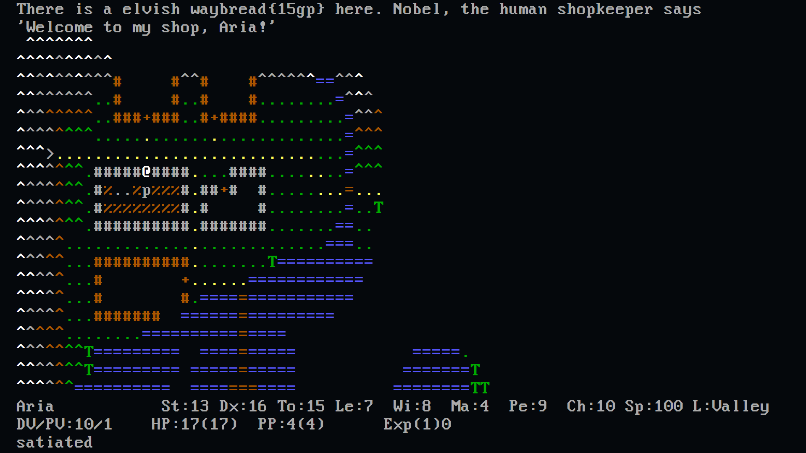
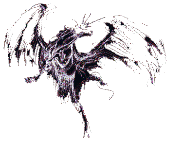

<!-- Original game 2000-2005 by Vadim Gaidukevich.
Avanor-Win32 is a native Win32/GDI port of Avanor,
original game 2000-2005 by Vadim Gaidukevich.
-->
𝐀𝐯𝐚𝐧𝐨𝐫-𝐖𝐢𝐧𝟑𝟐 𝐢𝐬 𝐚 𝐧𝐚𝐭𝐢𝐯𝐞 𝐖𝐢𝐧𝟑𝟐/𝐆𝐃𝐈 𝐩𝐨𝐫𝐭 𝐨𝐟 𝐀𝐯𝐚𝐧𝐨𝐫,
𝐨𝐫𝐢𝐠𝐢𝐧𝐚𝐥 𝐠𝐚𝐦𝐞 𝟐𝟎𝟎𝟎-𝟐𝟎𝟎𝟓 𝐛𝐲 𝐕𝐚𝐝𝐢𝐦 𝐆𝐚𝐢𝐝𝐮𝐤𝐞𝐯𝐢𝐜𝐡.

<!--
In ancient times the kingdom of Avanor was mighty, but it is now weak and
isolated from the neighboring lands by ranges of impassable mountains. Many
dreadful creatures have taken advantage of Avanor's isolation to wreak havoc
upon the surviving population. As one of Avanor's few remaining heroes, you
will no doubt wish to save the kingdom from the perils that have overtaken it.
-->
𝐈𝐧 𝐚𝐧𝐜𝐢𝐞𝐧𝐭 𝐭𝐢𝐦𝐞𝐬 𝐭𝐡𝐞 𝐤𝐢𝐧𝐠𝐝𝐨𝐦 𝐨𝐟 𝐀𝐯𝐚𝐧𝐨𝐫 𝐰𝐚𝐬 𝐦𝐢𝐠𝐡𝐭𝐲, 𝐛𝐮𝐭 𝐢𝐭 𝐢𝐬 𝐧𝐨𝐰 𝐰𝐞𝐚𝐤 𝐚𝐧𝐝
𝐢𝐬𝐨𝐥𝐚𝐭𝐞𝐝 𝐟𝐫𝐨𝐦 𝐭𝐡𝐞 𝐧𝐞𝐢𝐠𝐡𝐛𝐨𝐫𝐢𝐧𝐠 𝐥𝐚𝐧𝐝𝐬 𝐛𝐲 𝐫𝐚𝐧𝐠𝐞𝐬 𝐨𝐟 𝐢𝐦𝐩𝐚𝐬𝐬𝐚𝐛𝐥𝐞 𝐦𝐨𝐮𝐧𝐭𝐚𝐢𝐧𝐬. 𝐌𝐚𝐧𝐲
𝐝𝐫𝐞𝐚𝐝𝐟𝐮𝐥 𝐜𝐫𝐞𝐚𝐭𝐮𝐫𝐞𝐬 𝐡𝐚𝐯𝐞 𝐭𝐚𝐤𝐞𝐧 𝐚𝐝𝐯𝐚𝐧𝐭𝐚𝐠𝐞 𝐨𝐟 𝐀𝐯𝐚𝐧𝐨𝐫'𝐬 𝐢𝐬𝐨𝐥𝐚𝐭𝐢𝐨𝐧 𝐭𝐨 𝐰𝐫𝐞𝐚𝐤 𝐡𝐚𝐯𝐨𝐜
𝐮𝐩𝐨𝐧 𝐭𝐡𝐞 𝐬𝐮𝐫𝐯𝐢𝐯𝐢𝐧𝐠 𝐩𝐨𝐩𝐮𝐥𝐚𝐭𝐢𝐨𝐧. 𝐀𝐬 𝐨𝐧𝐞 𝐨𝐟 𝐀𝐯𝐚𝐧𝐨𝐫'𝐬 𝐟𝐞𝐰 𝐫𝐞𝐦𝐚𝐢𝐧𝐢𝐧𝐠 𝐡𝐞𝐫𝐨𝐞𝐬, 𝐲𝐨𝐮
𝐰𝐢𝐥𝐥 𝐧𝐨 𝐝𝐨𝐮𝐛𝐭 𝐰𝐢𝐬𝐡 𝐭𝐨 𝐬𝐚𝐯𝐞 𝐭𝐡𝐞 𝐤𝐢𝐧𝐠𝐝𝐨𝐦 𝐟𝐫𝐨𝐦 𝐭𝐡𝐞 𝐩𝐞𝐫𝐢𝐥𝐬 𝐭𝐡𝐚𝐭 𝐡𝐚𝐯𝐞 𝐨𝐯𝐞𝐫𝐭𝐚𝐤𝐞𝐧 𝐢𝐭.

<table>
    <tr>
        <td align="left" width="50%" valign="top">
             
        </td>
        <td align="left" width="50%" valign="top">
             
        </td>
    </tr>
    <tr>
        <td align="left" width="50%" valign="top">
             
        </td>
        <td align="left" width="50%" valign="top">
             
        </td>
    </tr>
    <tr>
        <td align="left" width="50%" valign="top">
             
        </td>
        <td align="left" width="50%" valign="top">
             
        </td>
    </tr>
</table>

<!--
Avanor-Win32 is a native Win32/GDI port of Avanor. It does not
change the original game mechanics in any way. A couple of minor 
++ modifications needed to be made for Win32 compilation.

The game can be played in windowed or full screen mode. Player
may choose different fonts and turn off/on the graphical background.

The release package contains the game executable, required files, 
and a printable pdf of the manual. Installation is not required. 

The game is compiled with Visual Studio 2022 command line - buildWin32.bat 
is included for ease. Other Visual Studio versions will likely work just 
as well, but haven't been tested. 64-bit compilation has been verified as 
working.

It is hoped that Avanor-Win32 can enable more people to discover and enjoy 
this great game. All credit for Avanor goes to Vadim Gaidukevich and the 
rest of the team whose names you will find in the game's help files.
-->

𝐀𝐯𝐚𝐧𝐨𝐫-𝐖𝐢𝐧𝟑𝟐 𝐢𝐬 𝐚 𝐧𝐚𝐭𝐢𝐯𝐞 𝐖𝐢𝐧𝟑𝟐/𝐆𝐃𝐈 𝐩𝐨𝐫𝐭 𝐨𝐟 𝐀𝐯𝐚𝐧𝐨𝐫. 𝐈𝐭 𝐝𝐨𝐞𝐬 𝐧𝐨𝐭
𝐜𝐡𝐚𝐧𝐠𝐞 𝐭𝐡𝐞 𝐨𝐫𝐢𝐠𝐢𝐧𝐚𝐥 𝐠𝐚𝐦𝐞 𝐦𝐞𝐜𝐡𝐚𝐧𝐢𝐜𝐬 𝐢𝐧 𝐚𝐧𝐲 𝐰𝐚𝐲. 𝐀 𝐜𝐨𝐮𝐩𝐥𝐞 𝐨𝐟 𝐦𝐢𝐧𝐨𝐫 
𝐂++ 𝐦𝐨𝐝𝐢𝐟𝐢𝐜𝐚𝐭𝐢𝐨𝐧𝐬 𝐧𝐞𝐞𝐝𝐞𝐝 𝐭𝐨 𝐛𝐞 𝐦𝐚𝐝𝐞 𝐟𝐨𝐫 𝐖𝐢𝐧𝟑𝟐 𝐜𝐨𝐦𝐩𝐢𝐥𝐚𝐭𝐢𝐨𝐧.

𝐓𝐡𝐞 𝐠𝐚𝐦𝐞 𝐜𝐚𝐧 𝐛𝐞 𝐩𝐥𝐚𝐲𝐞𝐝 𝐢𝐧 𝐰𝐢𝐧𝐝𝐨𝐰𝐞𝐝 𝐨𝐫 𝐟𝐮𝐥𝐥 𝐬𝐜𝐫𝐞𝐞𝐧 𝐦𝐨𝐝𝐞. 𝐏𝐥𝐚𝐲𝐞𝐫
𝐦𝐚𝐲 𝐜𝐡𝐨𝐨𝐬𝐞 𝐝𝐢𝐟𝐟𝐞𝐫𝐞𝐧𝐭 𝐟𝐨𝐧𝐭𝐬 𝐚𝐧𝐝 𝐭𝐮𝐫𝐧 𝐨𝐟𝐟/𝐨𝐧 𝐭𝐡𝐞 𝐠𝐫𝐚𝐩𝐡𝐢𝐜𝐚𝐥 𝐛𝐚𝐜𝐤𝐠𝐫𝐨𝐮𝐧𝐝.

𝐓𝐡𝐞 𝐫𝐞𝐥𝐞𝐚𝐬𝐞 𝐩𝐚𝐜𝐤𝐚𝐠𝐞 𝐜𝐨𝐧𝐭𝐚𝐢𝐧𝐬 𝐭𝐡𝐞 𝐠𝐚𝐦𝐞 𝐞𝐱𝐞𝐜𝐮𝐭𝐚𝐛𝐥𝐞, 𝐫𝐞𝐪𝐮𝐢𝐫𝐞𝐝 𝐟𝐢𝐥𝐞𝐬, 
𝐚𝐧𝐝 𝐚 𝐩𝐫𝐢𝐧𝐭𝐚𝐛𝐥𝐞 𝐩𝐝𝐟 𝐨𝐟 𝐭𝐡𝐞 𝐦𝐚𝐧𝐮𝐚𝐥. 𝐈𝐧𝐬𝐭𝐚𝐥𝐥𝐚𝐭𝐢𝐨𝐧 𝐢𝐬 𝐧𝐨𝐭 𝐫𝐞𝐪𝐮𝐢𝐫𝐞𝐝. 

𝐓𝐡𝐞 𝐠𝐚𝐦𝐞 𝐢𝐬 𝐜𝐨𝐦𝐩𝐢𝐥𝐞𝐝 𝐰𝐢𝐭𝐡 𝐕𝐢𝐬𝐮𝐚𝐥 𝐒𝐭𝐮𝐝𝐢𝐨 𝟐𝟎𝟐𝟐 𝐜𝐨𝐦𝐦𝐚𝐧𝐝 𝐥𝐢𝐧𝐞 - 𝐛𝐮𝐢𝐥𝐝𝐖𝐢𝐧𝟑𝟐.𝐛𝐚𝐭 
𝐢𝐬 𝐢𝐧𝐜𝐥𝐮𝐝𝐞𝐝 𝐟𝐨𝐫 𝐞𝐚𝐬𝐞. 𝐎𝐭𝐡𝐞𝐫 𝐕𝐢𝐬𝐮𝐚𝐥 𝐒𝐭𝐮𝐝𝐢𝐨 𝐯𝐞𝐫𝐬𝐢𝐨𝐧𝐬 𝐰𝐢𝐥𝐥 𝐥𝐢𝐤𝐞𝐥𝐲 𝐰𝐨𝐫𝐤 𝐣𝐮𝐬𝐭 
𝐚𝐬 𝐰𝐞𝐥𝐥, 𝐛𝐮𝐭 𝐡𝐚𝐯𝐞𝐧'𝐭 𝐛𝐞𝐞𝐧 𝐭𝐞𝐬𝐭𝐞𝐝. 𝟔𝟒-𝐛𝐢𝐭 𝐜𝐨𝐦𝐩𝐢𝐥𝐚𝐭𝐢𝐨𝐧 𝐡𝐚𝐬 𝐛𝐞𝐞𝐧 𝐯𝐞𝐫𝐢𝐟𝐢𝐞𝐝 𝐚𝐬 
𝐰𝐨𝐫𝐤𝐢𝐧𝐠.

𝐈𝐭 𝐢𝐬 𝐡𝐨𝐩𝐞𝐝 𝐭𝐡𝐚𝐭 𝐀𝐯𝐚𝐧𝐨𝐫-𝐖𝐢𝐧𝟑𝟐 𝐜𝐚𝐧 𝐞𝐧𝐚𝐛𝐥𝐞 𝐦𝐨𝐫𝐞 𝐩𝐞𝐨𝐩𝐥𝐞 𝐭𝐨 𝐝𝐢𝐬𝐜𝐨𝐯𝐞𝐫 𝐚𝐧𝐝 𝐞𝐧𝐣𝐨𝐲 
𝐭𝐡𝐢𝐬 𝐠𝐫𝐞𝐚𝐭 𝐠𝐚𝐦𝐞. 𝐀𝐥𝐥 𝐜𝐫𝐞𝐝𝐢𝐭 𝐟𝐨𝐫 𝐀𝐯𝐚𝐧𝐨𝐫 𝐠𝐨𝐞𝐬 𝐭𝐨 𝐕𝐚𝐝𝐢𝐦 𝐆𝐚𝐢𝐝𝐮𝐤𝐞𝐯𝐢𝐜𝐡 𝐚𝐧𝐝 𝐭𝐡𝐞 
𝐫𝐞𝐬𝐭 𝐨𝐟 𝐭𝐡𝐞 𝐭𝐞𝐚𝐦 𝐰𝐡𝐨𝐬𝐞 𝐧𝐚𝐦𝐞𝐬 𝐲𝐨𝐮 𝐰𝐢𝐥𝐥 𝐟𝐢𝐧𝐝 𝐢𝐧 𝐭𝐡𝐞 𝐠𝐚𝐦𝐞'𝐬 𝐡𝐞𝐥𝐩 𝐟𝐢𝐥𝐞𝐬.

