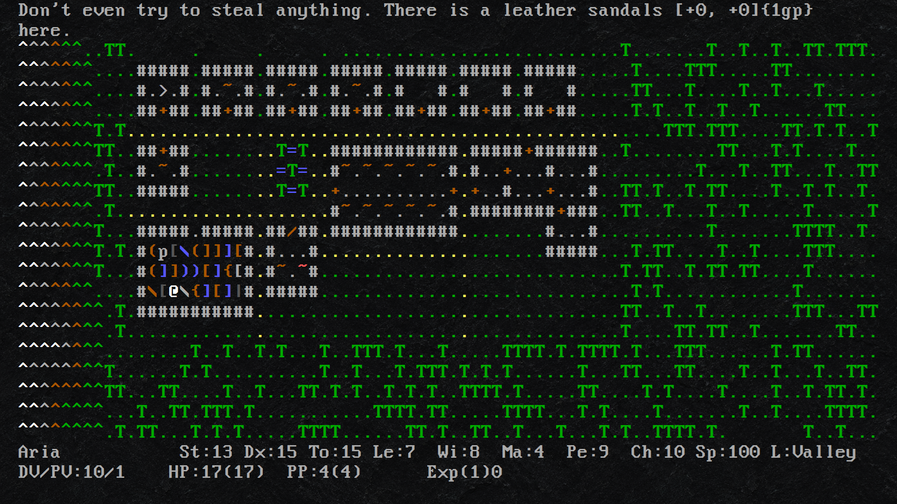

<!-- Original game 2000-2005 by Vadim Gaidukevich.
Avanor-Win32 is a native Win32/GDI port of Avanor,
original game 2000-2005 by Vadim Gaidukevich.
-->
𝐀𝐯𝐚𝐧𝐨𝐫-𝐖𝐢𝐧𝟑𝟐 𝐢𝐬 𝐚 𝐧𝐚𝐭𝐢𝐯𝐞 𝐖𝐢𝐧𝟑𝟐/𝐆𝐃𝐈 𝐩𝐨𝐫𝐭 𝐨𝐟 𝐀𝐯𝐚𝐧𝐨𝐫,
𝐨𝐫𝐢𝐠𝐢𝐧𝐚𝐥 𝐠𝐚𝐦𝐞 𝟐𝟎𝟎𝟎-𝟐𝟎𝟎𝟓 𝐛𝐲 𝐕𝐚𝐝𝐢𝐦 𝐆𝐚𝐢𝐝𝐮𝐤𝐞𝐯𝐢𝐜𝐡.

<!--
In ancient times the kingdom of Avanor was mighty, but it is now weak and
isolated from the neighboring lands by ranges of impassable mountains. Many
dreadful creatures have taken advantage of Avanor's isolation to wreak havoc
upon the surviving population. As one of Avanor's few remaining heroes, you
will no doubt wish to save the kingdom from the perils that have overtaken it.
-->
𝐈𝐧 𝐚𝐧𝐜𝐢𝐞𝐧𝐭 𝐭𝐢𝐦𝐞𝐬 𝐭𝐡𝐞 𝐤𝐢𝐧𝐠𝐝𝐨𝐦 𝐨𝐟 𝐀𝐯𝐚𝐧𝐨𝐫 𝐰𝐚𝐬 𝐦𝐢𝐠𝐡𝐭𝐲, 𝐛𝐮𝐭 𝐢𝐭 𝐢𝐬 𝐧𝐨𝐰 𝐰𝐞𝐚𝐤 𝐚𝐧𝐝
𝐢𝐬𝐨𝐥𝐚𝐭𝐞𝐝 𝐟𝐫𝐨𝐦 𝐭𝐡𝐞 𝐧𝐞𝐢𝐠𝐡𝐛𝐨𝐫𝐢𝐧𝐠 𝐥𝐚𝐧𝐝𝐬 𝐛𝐲 𝐫𝐚𝐧𝐠𝐞𝐬 𝐨𝐟 𝐢𝐦𝐩𝐚𝐬𝐬𝐚𝐛𝐥𝐞 𝐦𝐨𝐮𝐧𝐭𝐚𝐢𝐧𝐬. 𝐌𝐚𝐧𝐲
𝐝𝐫𝐞𝐚𝐝𝐟𝐮𝐥 𝐜𝐫𝐞𝐚𝐭𝐮𝐫𝐞𝐬 𝐡𝐚𝐯𝐞 𝐭𝐚𝐤𝐞𝐧 𝐚𝐝𝐯𝐚𝐧𝐭𝐚𝐠𝐞 𝐨𝐟 𝐀𝐯𝐚𝐧𝐨𝐫'𝐬 𝐢𝐬𝐨𝐥𝐚𝐭𝐢𝐨𝐧 𝐭𝐨 𝐰𝐫𝐞𝐚𝐤 𝐡𝐚𝐯𝐨𝐜
𝐮𝐩𝐨𝐧 𝐭𝐡𝐞 𝐬𝐮𝐫𝐯𝐢𝐯𝐢𝐧𝐠 𝐩𝐨𝐩𝐮𝐥𝐚𝐭𝐢𝐨𝐧. 𝐀𝐬 𝐨𝐧𝐞 𝐨𝐟 𝐀𝐯𝐚𝐧𝐨𝐫'𝐬 𝐟𝐞𝐰 𝐫𝐞𝐦𝐚𝐢𝐧𝐢𝐧𝐠 𝐡𝐞𝐫𝐨𝐞𝐬, 𝐲𝐨𝐮
𝐰𝐢𝐥𝐥 𝐧𝐨 𝐝𝐨𝐮𝐛𝐭 𝐰𝐢𝐬𝐡 𝐭𝐨 𝐬𝐚𝐯𝐞 𝐭𝐡𝐞 𝐤𝐢𝐧𝐠𝐝𝐨𝐦 𝐟𝐫𝐨𝐦 𝐭𝐡𝐞 𝐩𝐞𝐫𝐢𝐥𝐬 𝐭𝐡𝐚𝐭 𝐡𝐚𝐯𝐞 𝐨𝐯𝐞𝐫𝐭𝐚𝐤𝐞𝐧 𝐢𝐭.

## Screenshots

<table>
    <tr>
        <td align="left" width="50%" valign="top">
             
        </td>
        <td align="left" width="50%" valign="top">
             
        </td>
    </tr>
    <tr>
        <td align="left" width="50%" valign="top">
             
        </td>
        <td align="left" width="50%" valign="top">
             
        </td>
    </tr>
    <tr>
        <td align="left" width="50%" valign="top">
             
        </td>
        <td align="left" width="50%" valign="top">
             
        </td>
    </tr>
</table>

Avanor-Win32 is a native Win32/GDI port of Avanor. It does not change the original game mechanics in any way. A couple of minor C++ modifications needed to be made for Win32 compilation.

The game can be played in windowed or full screen mode. Player may choose different fonts and turn off/on the graphical background.

The release package contains the game executable, required files, and a printable pdf of the manual. Installation is not required. 

The game is compiled with Visual Studio 2022 command line - buildWin32.bat is included for ease. Other Visual Studio versions will likely work just as well, but haven't been tested. 64-bit compilation has been verified as working.

It is hoped that Avanor-Win32 can enable more people to discover and enjoy this great game. All credit for Avanor goes to Vadim Gaidukevich and the rest of the team whose names you will find in the game's help files.

