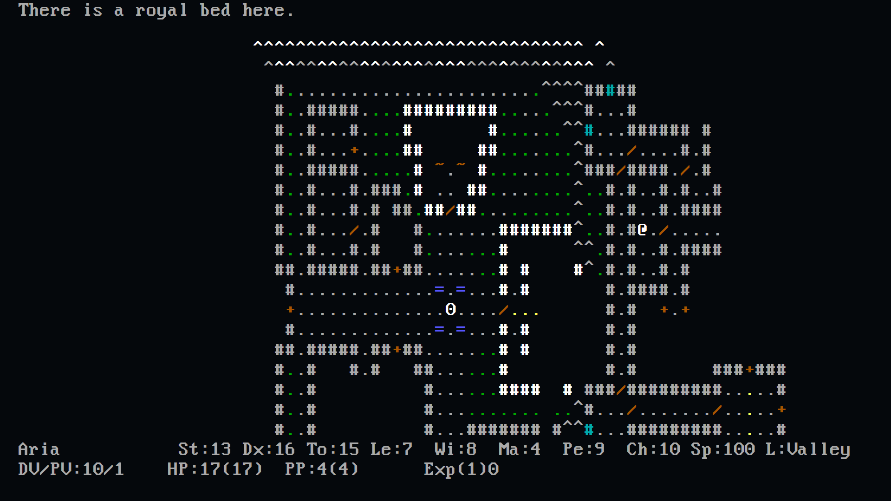
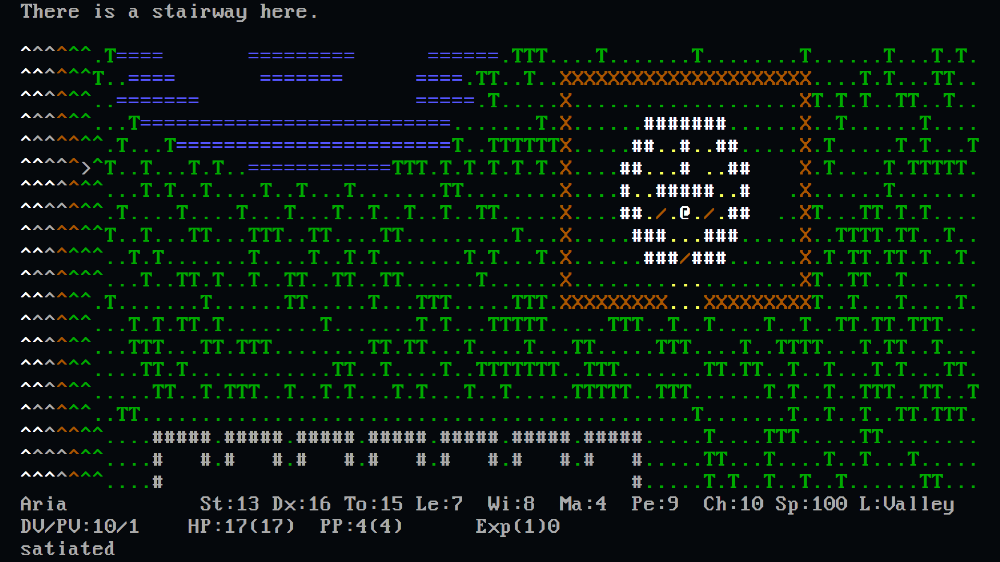

# Avanor-Win32

**A fantasy rogue-like role-playing game.**

In ancient times the kingdom of Avanor was mighty, but it is now weak and isolated from the neighboring lands by ranges of impassable mountains. Many dreadful creatures have taken advantage of Avanor's isolation to wreak havoc upon the surviving population. As one of Avanor's few remaining heroes, you will no doubt wish to save the kingdom from the perils that have overtaken it.

## Screenshots

<table>
    <tr>
        <td align="left" width="50%" valign="top">
             
        </td>
        <td align="left" width="50%" valign="top">
             
        </td>
    </tr>
    <tr>
        <td align="left" width="50%" valign="top">
             
        </td>
        <td align="left" width="50%" valign="top">
             
        </td>
    </tr>
</table>

